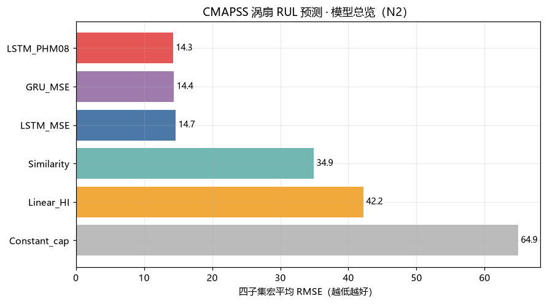

# CMAPSS 涡扇发动机退化建模与 RUL 预测（N2）




NASA CMAPSS 涡扇退化仿真（FD001–FD004）上「多传感器运行轨迹 → 剩余寿命（RUL）」的
完整基准：**4 个子集 × 3 类基线 × LSTM/GRU × 2 种损失**，按子集分解 RMSE 与 PHM08 score。

**先看这 7 件事：**

1. **链接坑**：NASA PCoE 仓库的「#17 Turbofan Degradation-2」是 15.76 GB 的 N-CMAPSS，
   经典 FD001–FD004 在 **#6**（12.4 MB）。数据直链与验证见 [`_说明.md`](../docs/) 与仓库 `docs/`。
2. **piecewise RUL 封顶 125** 是标配：训练引擎寿命 128–543 周期，不封顶会让长寿命引擎主导损失。
3. **验证必须按引擎划分**：同引擎相邻窗口强相关，按窗口随机划分会泄漏。
4. **PHM08 损失不只是换了个分数**：把误差不对称（晚预测惩罚 exp(d/10)、早预测 exp(-d/13)）
   直接当损失，FD001 的偏差从 +4.9 cycle 拉到 +0.3，score 降 ~20%。
5. **相似度匹配基线不弱**：零学习的滑窗相关匹配在宏 RMSE 上就能到 34.9
   （常数 64.9 / 线性外推 42.2），且天然偏早——按 PHM08 口径反而更安全。
6. **末窗 RMSE 会骗人**（v1.1）：全寿命滚动预测后，临近失效 RMSE 只有 **4–10**，
   早期（真值 >200）是 116–163——早期误差来自标签封顶（cap=125），不是模型坏。
   运维真正需要的"临近失效准不准"，答案比头号数字好 1.5–3 倍。
7. **三模型分歧就是免费的置信度**（v1.1）：LSTM_MSE/LSTM_PHM08/GRU_MSE 的预测 std
   与误差显著正相关（Spearman ρ 0.14–0.49），高分歧三分位的 MAE 是低分歧的 1.4–2.4 倍；
   三模型集成还把宏 RMSE 再降 0.33（14.05→13.72）。
8. **零样本跨子集迁移不可部署**（v1.1）：FD001→FD003 缺口 +8.2、FD002→FD004 +20.8 RMSE，
   且迁移预测**系统性偏晚**（+4～+17 cycle）——PHM08 score 暴涨 32–177 倍。
   对比 N1 轴承跨载荷几乎不掉点：涡扇的域偏移难得多。
9. **选检核点比换损失更值钱**（v1.2）：早停判据从验证 RMSE 换成验证 PHM08 score，
   测试 score 免费降 17–29%；最优格对 v1.0 基线 FD001 414→277（−33%）、FD004 1529→1040。
   优先级：**按最终指标选检核点 > 换损失 > 换结构**。
10. **"清零偏差"是 RMSE 思维的陷阱**（v1.2）：分数选模型最优位置在偏早侧，
    后验偏差校正推向偏晚重罚区，score 反噬 9–27%——偏差的方向比大小重要。
11. **结构升级在小数据上无效；对称共形 4/4 命中名义覆盖**（v1.2）：LSTM+Attn ≈ 取末步，
    Transformer score 1.3–2.8 倍；共形-对称区间覆盖 0.890–0.923 全落 0.90±0.05。

## 数据

NASA PCoE「Turbofan Engine Degradation Simulation」（Saxena & Goebel 2008），
直链 `https://phm-datasets.s3.amazonaws.com/NASA/6.+Turbofan+Engine+Degradation+Simulation+Data+Set.zip`（12.4 MB）。
本地落位 `D:/项目/02_数据集/01_国际公开集/CMAPSS_涡扇/raw/`（可用环境变量 `CMAPSS_DATA_ROOT` 覆盖）。

| 子集 | 训练/测试引擎 | 工况 | 故障模式 | 训练/测试行数 |
|---|---|---|---|---|
| FD001 | 100 / 100 | 1 | HPC | 20,631 / 13,096 |
| FD002 | 260 / 259 | 6 | HPC | 53,759 / 33,991 |
| FD003 | 100 / 100 | 1 | HPC + Fan | 24,720 / 16,596 |
| FD004 | 249 / 248 | 6 | HPC + Fan | 61,249 / 41,214 |

每行 26 列：`unit_id, cycle, op_setting 1–3, sensor 1–21`。
训练集 run-to-failure；测试集截断 + `RUL_FDxxx.txt` 给真实剩余寿命。

## Results

<!-- RESULTS_TABLE_START -->
**RMSE**（越小越好；深度模型为 2 个种子均值±std）：

| 模型 | FD001 | FD002 | FD003 | FD004 | 宏平均 |
|---|---|---|---|---|---|
| 常数封顶（RUL=125） | 64.51 | 66.91 | 64.49 | 63.79 | 64.93 |
| 线性 HI 外推 | 35.85 | 45.96 | 42.88 | 44.16 | 42.21 |
| 相似度匹配 | 41.43 | **27.93** | 36.97 | 33.33 | 34.92 |
| LSTM（MSE 损失） | 14.47±0.17 | 14.02±0.17 | 14.12±1.22 | 15.99±0.00 | 14.65 |
| LSTM（PHM08 损失） | 14.14±0.18 | 14.36±0.41 | **12.83±0.13** | 15.76±0.03 | **14.27** |
| GRU（MSE 损失） | **13.92±0.49** | 14.48±0.44 | 13.54±0.80 | **15.64±0.25** | 14.39 |

**PHM08 score**（总分；除以测试引擎数得每引擎平均，深度模型量级上比基线小 1–3 个数量级）：

| 模型 | FD001 (100) | FD002 (259) | FD003 (100) | FD004 (248) | 每引擎平均（四集） |
|---|---|---|---|---|---|
| 常数封顶 | 1,502,461 | 5,161,053 | 1,390,882 | 4,028,362 | ~16,000 |
| 线性 HI 外推 | 71,150 | 1,498,425 | 199,004 | 1,298,030 | ~3,300 |
| 相似度匹配 | 12,445 | 11,073 | 8,144 | 37,210 | 43–150 |
| LSTM（MSE） | 414 | 1,093 | 334 | 1,529 | 4–6 |
| LSTM（PHM08） | **338** | **1,018** | **264** | **1,253** | **3–5** |
| GRU（MSE） | 405 | 1,140 | 498 | 1,748 | 4–7 |

**偏差**（mean_error = pred − true，>0 偏晚更危险）：

| 模型 | FD001 | FD002 | FD003 | FD004 |
|---|---|---|---|---|
| 相似度匹配 | **−31.9** | −9.4 | −21.2 | −13.2 |
| LSTM（MSE） | +4.5 | +0.5 | +2.1 | +1.3 |
| LSTM（PHM08） | **−0.0** | −1.2 | +1.0 | +0.3 |
| GRU（MSE） | +3.7 | −0.4 | +2.7 | +0.2 |

要点：

- **深度模型把宏 RMSE 从 34.9 压到 14.3**（−59%），四个子集全优于三个基线。
- **PHM08 损失把偏差拉近 0**：FD001 上 LSTM_MSE 偏晚 +4.5 cycle，LSTM_PHM08 只有 −0.02；
  PHM08 score 也降 ~20%（414→338）。RMSE 也顺带略降（14.47→14.14）。
- **RMSE 差距小、PHM08 差距大**：LSTM/GRU 三者 RMSE 都在 13–16，但 score 能差 2 倍——
  只报 RMSE 会低估损失设计的价值。
- **相似度匹配是"偏早但安全"的基线**：偏差 −10～−32 cycle（早预测），RMSE 比线性外推好，
  PHM08 更是低 1–2 个数量级；工程上这是个不该被跳过的对照。
- FD003 上 LSTM_PHM08（12.83）显著好于 LSTM_MSE（14.12±1.22），且种子间更稳（std 0.13 vs 1.22）——
  多故障模式子集上不对称损失的收益更大。


图：`fig09_baseline_vs_deep.png`（基线 vs 深度 RMSE/score）、`fig10_bias.png`（偏差分布）、
`fig07_deep_rmse.png`、`fig06_baselines_rmse.png`、`fig02_piecewise_rul.png`（RUL 封顶示意）等 21 张，见 `results/figures/`。

**v1.1 深化（scripts/06–08）：**

- **滚动预测**（fig12）：LSTM_PHM08 按真值 RUL 分桶的 RMSE——0–25: 4.2/6.1/7.7/9.7，
  50–75: 18–24，>200: 116–163（FD001/2/3/4）。末窗 13–16 是全寿命混合产物。
- **集成**（fig13）：三模型平均宏 RMSE 13.72（最优单模型 14.05），PHM08 3/4 子集最优。
- **不确定性**（fig13）：三模型预测 std 的三分位 MAE 严格单调（如 FD004: 6.2→11.0→14.8），
  Spearman ρ 0.14–0.49 全显著——模型分歧是可用的置信度代理。
- **跨子集迁移**（fig14）：零样本迁移 RMSE 21.1/36.6/24.0（FD001→FD003 / FD002→FD004 /
  FD001→FD002），oracle 13.0/15.8/14.0，缺口 +8.2/+20.8/+10.1，且全部偏晚。
**v1.2 深化（scripts/09–11）：**

- **分数感知选模**（fig21）：损失×选模 2×2 矩阵——FD001 mse_rmse 414 / mse_score 292 /
  phm08_rmse 338 / **phm08_score 277**；FD004 1529/1218/1252/**1040**。选模判据贡献大于损失。
- **偏差校正**（fig21）：只在 mse+RMSE选 上微赚 1–3%，分数选模型全部反噬 9–27%。
- **注意力/Transformer**（fig22）：LSTM+Attn 与取末步等价；Transformer 全面劣化
  （FD001 score 414→1055，最优轮次 2–9，种子方差 ±234）——负结果。
- **区间校准**（fig23）：90% 名义覆盖——共形-对称 0.890/0.915/0.923/0.910（4/4 落入
  0.90±0.05，比 naive 窄 14–23%）；pinball 最窄（25.6–42.2）但 FD003 覆盖 0.810 欠覆盖。

**v1.3 深化（scripts/12–15）：**

- **pinball+共形二段缩放**（fig24）：FD003 欠覆盖 0.810 → **0.920**（CQR Q=5.81 / λ=1.45），
  宽度 37 仍比共形-对称 57 窄 35%；已准子集 Q=0/λ=1 原样通过——二段缩放是"免费保险"。
  分层共形（协变量自适应）全面劣于宽度自适应。
- **在线后处理三件套全负结果**（fig26）：单调修复违反率 0.65–0.77→0.000 但 RMSE +4~7%
  （被禁止的"向上修订"恰是修正信号，均 err −28）；门控分数与误差**负**相关
  （ρ −0.11~−0.54，早期 cap 饱和区低分歧大错），AURC 差于随机。
- **域适应**（fig25）：CORAL/MMD 边际对齐在条件偏移下 2/3 对**负迁移**；
  few-shot k=5 在最难对 FD002→FD004 上缺口 23.95→**4.71**（关闭 80%）且修掉
  系统性偏晚——迁移缺口主要是条件映射偏移而非表征错位。

<!-- RESULTS_TABLE_END -->

评估协议：训练集内部按引擎 80/20 划分验证（早停）；测试集每引擎取**末窗**预测 RUL，
与 `RUL_FDxxx` 对齐；RUL 标签与评估均按 cap=125 截断。指标：RMSE + PHM08 score
（晚预测 `exp(d/10)-1`，早预测 `exp(-d/13)-1`，晚预测惩罚更重）。

## Quick start

```bash
pip install -r requirements.txt

# 数据（12.4 MB）
mkdir -p data && cd data
curl -L -o cmapss.zip "https://phm-datasets.s3.amazonaws.com/NASA/6.+Turbofan+Engine+Degradation+Simulation+Data+Set.zip"
python -c "import zipfile; z=zipfile.ZipFile('cmapss.zip'); import os; z.extractall('.'); [zipfile.ZipFile(os.path.join(r,f)).extractall('.') for r,_,fs in os.walk('.') for f in fs if f.endswith('.zip') and 'cmapss' not in f.lower()]"
cd ..

python scripts/00_verify_data.py      # 校验 12 个 txt
python scripts/01_eda.py              # 寿命分布/标签/退化轨迹/工况聚类
python scripts/02_baselines.py        # 常数 / 线性 HI / 相似度匹配
python scripts/03_train_lstm.py       # LSTM/GRU × MSE/PHM08（CPU 可跑，约 2-3 h）
python scripts/04_error_analysis.py   # 对比表与偏差分析
python scripts/05_make_figures.py     # hero 图
python scripts/06_rolling.py          # v1.1 全寿命滚动预测（复用 03 权重）
python scripts/07_ensemble.py         # v1.1 三模型集成 + 不确定性代理（复用 03 权重）
python scripts/08_cross_transfer.py   # v1.1 跨子集迁移 + oracle 对照（重训，约 25 min）
python scripts/09_score_aware.py      # v1.2 损失×选模准则矩阵 + 偏差校正（重训，约 2 h）
python scripts/10_attention.py        # v1.2 注意力池化 / Transformer vs LSTM（重训，约 2 h）
python scripts/11_calibration.py      # v1.2 预测区间校准：共形/分位数（复用 09 权重 + pinball）
python scripts/12_two_stage_intervals.py  # v1.3 pinball+共形二段缩放（复用 09/11 检查点）
python scripts/13_domain_adaptation.py    # v1.3 CORAL/MMD/few-shot 域适应（重训，约 30 min）
python scripts/14_online_gating.py        # v1.3 在线门控/单调修复/重标定（复用 03 权重）
python scripts/15_summary_v13.py          # v1.3 汇总表
```

或 `bash run_all.sh`。测试：`pytest tests -q`（73 项，纯合成信号，不依赖数据集）。

## 方法

1. **预处理**：剔除近常数传感器（FD001 保留 14/21）→ 工况聚类（FD002/4 六工况
   KMeans on 3 个工况设定）→ 按工况 z-score（统计只来自训练集）
2. **标签**：piecewise 线性 RUL——早期常数 125，末段线性降到 0
3. **基线**：
   - 常数封顶（下界）
   - 线性 HI 外推：末窗传感器均值对 cycle 回归外推到失效阈值
   - 相似度匹配：测试末窗 vs 训练引擎全部滑窗的 Pearson 相关，top-10 加权剩余寿命
4. **深度**：LSTM/GRU（128 hidden × 2 层）+ 全连接头，输入 30 周期窗口；
   损失 MSE 或 **PHM08 score（可微）**；AdamW + 余弦退火 + 早停
5. **评估**：RMSE + PHM08 score + 早晚偏差，按子集分解

## Layout

```
src/cmapss_rul/    io / preprocessing / models / evaluation / plots
                   / intervals / adaptation / online（v1.3）
scripts/           00–05 流水线（校验/EDA/基线/深度/误差分析/汇总图）
                   06–08 v1.1 · 09–11 v1.2 · 12–15 v1.3
configs/           config.yaml
tests/             73 项单测（合成信号 + 分位数/共形/对齐损失/在线后处理）
reports/           基准评测报告-N2.md / 工作记录-N2.md
results/           metrics/（json）+ figures/（png）
```

## 边界与负结果

1. **常数封顶不是弱基线那么简单**：RMSE 64.9 差，但它是"乐观上界"参照——所有模型
   的价值就是比"一律 125"好多少。
2. **线性 HI 外推系统性偏晚**（平均 +26 cycle）：传感器均值的线性趋势在退化末期
   并不线性，外推会高估 RUL——恰好是 PHM08 最惩罚的方向。
3. **相似度匹配偏早**（平均 −17 cycle）：训练引擎失效前的相关峰往往提前出现。
   按 RMSE 它不如好 LSTM，按 PHM08 score 它常常反超线性基线——**指标选择改变结论**。
4. **readme.txt 的 FD004 计数是错的**（写 248/249，实际 249/248），以数据文件为准。
5. **v1.1 已补**：滚动预测（临近失效 RMSE 4–10）、三模型集成（宏 13.72）、
   模型分歧作不确定性代理（ρ 0.14–0.49）、跨子集迁移缺口量化（+8～+21 且偏晚）。
6. **v1.2 已补**：分数选模矩阵（FD001 414→277）、偏差校正的反噬机制、
   注意力/Transformer 对照（负结果）、真分位数回归 + 共形区间（4/4 命中名义覆盖）。
   **仍未做**：pinball+共形二段缩放、加权/协变量自适应共形、在线门控/重标定、
   域适应/few-shot 适配（迁移缺口已量化但未缩小）；选模矩阵在 FD002/003 只有对角。

## 引用

- 数据：A. Saxena and K. Goebel (2008), *Turbofan Engine Degradation Simulation Data Set*,
  NASA Prognostics Data Repository.
- 论文：Saxena et al., *Damage propagation modeling for aircraft engine run-to-failure
  simulation*, IEEE PHM 2008 (DOI: 10.1109/PHM.2008.4711414)
- 评分函数：PHM08 Challenge（Heimes 2008）

License: MIT
